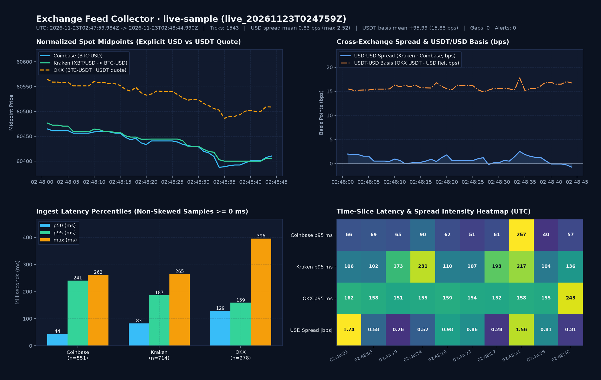

# Exchange Feed Collector

Collects real-time public market ticks from Coinbase, Kraken, and OKX into an idempotent SQLite WAL store, auto-recovers stream drops via REST backfill, and computes cross-exchange spreads without conflating `USD` and `USDT` quotes.

**Reference implementation · live public exchange sample + deterministic offline replay**



## Quick start

```bash
uv sync && make demo      # deterministic 60s offline replay -> SQLite WAL + HTML/PNG/JSON report
make live-sample          # capture 45s of live Coinbase, Kraken, and OKX public feeds
make test                 # run unit, concurrency, and end-to-end tests
```

## Reproducible results

Both runs below were executed locally against the repository code after final edits (`make soak` is included for future 72-hour runs; no 72-hour soak results are claimed here), and structured JSON summaries are emitted to `reports/<run_id>_summary.json`:

| Metric | Deterministic Replay (`make demo`) | Live Capture (`make live-sample`) |
| --- | --- | --- |
| Run ID | `demo_fixture_v1` | `live_20261123T024759Z` |
| UTC Window | `2026-11-23T01:00:00.000Z` → `01:00:59.000Z` | `2026-11-23T02:47:59.984Z` → `02:48:44.990Z` |
| Total Stored Ticks | `177` (deduplicated from `179` raw inputs; `2` duplicates) | `1,543` (deduplicated from `1,614` raw inputs; `71` duplicates) |
| Venue Breakdown | Coinbase `60` ws · Kraken `54` ws + `3` backfill · OKX `60` ws | Coinbase `551` ws · Kraken `714` ws · OKX `278` ws |
| Live Ingest Latency (`p50` / `p95` / `max`, non-skewed `>= 0 ms`) | CB `49.5`/`69.15`/`72.0` (`58/60`) · KR `89.0`/`131.7`/`136.0` · OKX `103.5`/`135.1`/`139.0` ms | CB `44.0`/`241.0`/`262.0` · KR `83.0`/`186.7`/`265.0` · OKX `129.0`/`159.0`/`396.0` ms |
| Clock-Skew Rows Flagged (`< 0 ms`) | `2` (Coinbase ahead of local wall clock, `raw_min -220.0 ms`) | `0` |
| Same-Quote USD Spread (`BTC-USD`) | Mean `+$7.93` · `1.31 bps` abs (`+1.31 bps` signed) · `18.84 bps` max (`57` buckets) | Mean `+$4.56` · `0.83 bps` abs (`+0.75 bps` signed) · `2.52 bps` max (`44` buckets) |
| Cross-Quote Basis (`BTC-USDT` vs `BTC-USD`) | Mean `+$89.27` · `14.70 bps` abs (`+14.70 bps` signed) · `15.95 bps` max (`60` buckets) | Mean `+$95.99` · `15.88 bps` abs (`+15.88 bps` signed) · `17.79 bps` max (`44` buckets) |
| Gaps & Alerts | `1` gap (`7,000 ms`, `recovered`, `3` rows) · `4` alerts | `0` gaps · `0` alerts |

## What breaks in production & how this handles it

1. **WebSocket silent half-open drops**: TCP sockets can hang without FIN/RST frames. `FeedCollector._receive_ws_msg` ([collector.py](src/exchange_collector/collector.py)) races reads against `ws_receive_timeout_seconds` and `StaleFeedMonitor.check_stale` ([resilience.py](src/exchange_collector/resilience.py)), forcing disconnect and REST fallback on silence. `CircuitBreaker` and `BackoffPolicy.delay_for_attempt` only reset after at least one valid parsed market tick is persisted to SQLite.
2. **Sequence and timestamp gaps**: Packet loss or reconnect windows leave missing price history. `GapDetector.observe` ([resilience.py](src/exchange_collector/resilience.py)) tracks timestamp gaps (`> gap_threshold_ms`) and high-threshold sequence jumps (`sequence_jump_threshold = 500`, keeping Coinbase `trade_id` separate from book `sequence`) without letting `rest_backfill` rows regress watermarks. `FeedCollector._schedule_backfill` marks a gap `recovered` only when REST backfill inserts `>= 1` genuinely new row inside `[gap_start_ms, gap_end_ms]` (otherwise `no_overlap` or `unrecovered`).
3. **Cross-exchange quote currency mismatch (`USD` vs `USDT`)**: Treating `BTC-USDT` as `1:1` with `BTC-USD` creates phantom ~$90–$100 arbitrage signals. `normalize_symbol` ([adapters.py](src/exchange_collector/adapters.py)) maps `XBT/USD` → `BTC-USD` (`USD`) while preserving `BTC-USDT` (`USDT`), and `compute_spread_buckets` / `summarize_spreads` ([analytics.py](src/exchange_collector/analytics.py)) keep same-quote `usd_spread_*` strictly separate from `usdt_basis_*` (reporting both absolute and signed bps).
4. **Same-millisecond collisions & SQLite lock contention**: Concurrent async streams hitting SQLite per message cause `database is locked` errors, while naïve `(exchange, symbol, ts_ms, source)` uniqueness drops same-millisecond fills or overwrites prior runs. `MarketStorage` ([storage.py](src/exchange_collector/storage.py)) enables `WAL` mode, `synchronous=NORMAL`, and `busy_timeout=5000`, enforces `UNIQUE(run_id, exchange, symbol, ts_ms, source, dedup_seq)` with `INSERT OR IGNORE` (returning exact `(inserted, duplicate)` counts via `total_changes`), and batches writes via `FeedCollector._flush_pending_ticks`.
5. **Clock skew & stale-feed false positives**: Comparing exchange event timestamps against local wall clock triggers bogus stale alerts when NTP drifts or an upstream server runs ahead. `StaleFeedMonitor.record_activity` ([resilience.py](src/exchange_collector/resilience.py)) tracks feed liveness exclusively via `time.monotonic()`, flags `SkewObservation` separately, and `MarketStorage.get_latency_percentiles` computes `p50`/`p95`/`max` strictly over non-skewed samples (`latency_ms >= 0`) while reporting `raw_count`, `non_skewed_count`, and `skewed_count` explicitly.

## Limitations

- Collects **public L1 ticker and recent trade feeds only** — does not reconstruct L2/L3 order-book depth, private fills, or execution routing.
- **Single-node SQLite WAL persistence** targets single-host monitoring and historical spread analysis (observed ~34 ticks/sec across 3 live pairs; high-throughput sustained ceiling is not benchmarked here), not distributed multi-region HFT matching.
- **REST backfill granularity** is bounded by each exchange's public recent-trades endpoint (latest ~100 trades without historical bid/ask quotes during outage windows).

## Project layout

- [src/exchange_collector/adapters.py](src/exchange_collector/adapters.py) — Coinbase, Kraken, and OKX public WS + REST adapters & quote normalization
- [src/exchange_collector/resilience.py](src/exchange_collector/resilience.py) — Backoff, circuit breaker, monotonic stale-feed monitor, gap detector, REST rate limiter
- [src/exchange_collector/storage.py](src/exchange_collector/storage.py) — SQLite WAL schema, idempotent upsert/dedup, latency percentiles
- [src/exchange_collector/analytics.py](src/exchange_collector/analytics.py) — Aligned spread & basis buckets, anomaly alerts, heatmap slice aggregation
- [src/exchange_collector/report.py](src/exchange_collector/report.py) — Self-contained HTML report and PNG chart rendering
- [src/exchange_collector/cli.py](src/exchange_collector/cli.py) — `demo`, `live-sample`, `soak`, and `report` subcommands
- [DESIGN_NOTES.md](DESIGN_NOTES.md) — Architectural tradeoffs and engineering walkthrough

Built with AI-assisted tooling; architecture, review, and tests by me.
